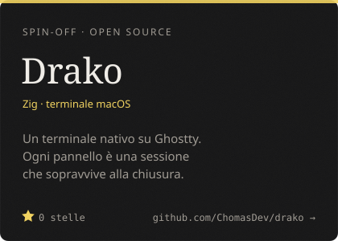
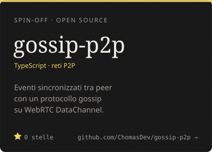
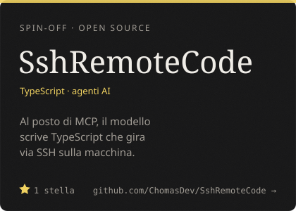

 

### Episodi

<table>
  <tr>
    <td width="33%" valign="top">
      
      Il ragazzo che nessuno notava ha mandato 1.900 email in un colpo solo.
    </td>
    <td width="33%" valign="top">
      
      Di giorno lo stage. Di notte, app che nessuno mi aveva chiesto.
    </td>
    <td width="33%" valign="top">
      
      Quello invisibile, davanti a sessanta persone.
    </td>
  </tr>
  <tr>
    <td width="33%" valign="top">
      
      Settimane di codice nel parcheggio, dopo il lavoro.
    </td>
    <td width="33%" valign="top">
      
      Ero appoggiato a un muro in discoteca. Ne è uscita una startup.
    </td>
    <td width="33%" valign="top">
      
      Un sistema operativo per agenti AI. Senza cervello, apposta.
    </td>
  </tr>
</table>

### Spin-off

<table>
  <tr>
    <td width="33%"></td>
    <td width="33%"></td>
    <td width="33%"></td>
  </tr>
</table>

### Ascolti

 

I fotogrammi sono SVG generati da <a href="scripts/build.mjs">scripts/build.mjs</a>. Gli ascolti si aggiornano ogni giorno con una GitHub Action.
