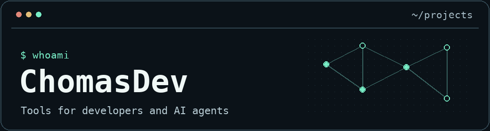

# ChomasDev

I build developer tools, AI infrastructure, and peer-to-peer systems.

## Featured projects

| Project | What it does |
| --- | --- |
| [Drako](https://github.com/ChomasDev/drako) | A native macOS terminal built on Ghostty, with persistent sessions for every pane. |
| [PLAIOS](https://github.com/ChomasDev/plaios) | A pluggable AI operating system with shared contracts, a UI kit, and a CLI. |
| [gossip-p2p](https://github.com/ChomasDev/gossip-p2p) | A TypeScript library for syncing events between peers over WebRTC. |
| [SshRemoteCode](https://github.com/ChomasDev/SshRemoteCode) | A TypeScript library for importing remote modules and calling their functions over SSH. |

## GitHub activity

